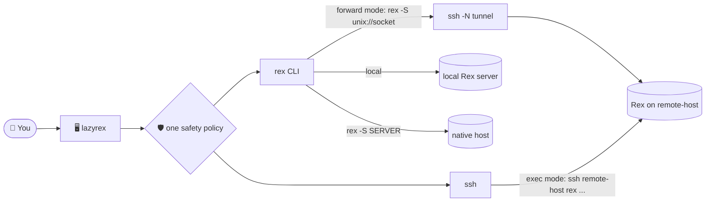

# lazyrex

A lazygit-style terminal UI for the Rex terminal multiplexer: every session, window, block and client of the Rex servers you reach, one key away.

lazyrex lists sessions, windows, blocks and clients in side panels, shows the selected item's capture or inspect output in the main view, and writes every `rex` command it runs to a command log. It manages the **local** Rex server, **native hosts** reached through `rex -S SERVER`, and **SSH targets**, Rex servers on other machines reached through `ssh`.

<!-- screenshot: record with vhs or asciinema and replace this comment with  -->



## Install

Requires Go 1.26 and `rex` (API revision 9) in `PATH`. SSH targets also need OpenSSH's `ssh` and a private `$XDG_RUNTIME_DIR` ([SSH targets](docs/ssh.md)).

```sh
go install github.com/rbobillot/lazyrex/cmd/lazyrex@latest
# or, from a checkout:
go build -o /tmp/lazyrex ./cmd/lazyrex
```

## Quickstart

```sh
lazyrex                          # the local server, config targets and discovered hosts
lazyrex -S studio                # start on a config target, a rex hosts label, host:port or URL
lazyrex --ssh user@remote-host   # start on an SSH target
```

| Key | Does |
|---|---|
| `1`–`5`, `tab` | jump to Targets, Sessions, Windows, Blocks, Clients; next panel |
| `j` / `k`, `enter` | move, then activate, scope or open the selected item |
| `[` / `]` | switch the main view's tab (Capture, Inspect, Status...) |
| `x` | action menu of the focused panel |
| `:` | command palette: `api call` and `do`, with `tab` completion |
| `?` | every key of the focused panel; `enter` runs one |
| `@`, `q` | focus the command log; quit |

[Getting started](docs/getting-started.md) walks through the panels and first actions.

## Documentation

| Page | For |
|---|---|
| [Docs home](docs/index.md) | What to read first |
| [Getting started](docs/getting-started.md) | Install, first run, the panels, moving around |
| [Targets](docs/targets.md) | Local server, native hosts, SSH targets, `--server` and `--ssh` |
| [SSH targets](docs/ssh.md) | Forward and exec modes, probes, fallbacks, SSH troubleshooting |
| [Keys](docs/keys.md) | Every keybinding and how to override it |
| [Actions](docs/actions.md) | Action menus, forms, server and client actions, the command palette |
| [Safety](docs/safety.md) | What lazyrex refuses, confirms and redacts |
| [Configuration](docs/configuration.md) | Every config key and its default |
| [Troubleshooting](docs/troubleshooting.md) | Target states, errors and exit codes |
| [Architecture](docs/architecture.md) | Packages, transports, events and polling |
| [Development](docs/development.md) | Building, tests, the multi-agent harness |

## Safety

lazyrex never starts a server you did not ask for (every other call passes `--autostart=false`), never changes hosts, pairing, listeners or Tailscale, never sends input to or closes the block it runs in, and never steals focus from a Rex app. Destructive commands show the exact command before they run, and payloads are redacted in the command log. Details: [Safety](docs/safety.md).

## Development

```sh
go test ./...
go build -o /tmp/lazyrex ./cmd/lazyrex
```

Tests never run the real `rex` except an opt-in, read-only smoke test. See [Development](docs/development.md) and [AGENTS.md](AGENTS.md).

## License

Apache-2.0, see [LICENSE](LICENSE).
