# Actions

> **What each action does, the prompts it asks, and the exact `rex` command it runs: panel keys, the `x` action menus, server and client actions with forms built from their JSON Schema, pane resizing, and the `:` command palette.** Whatever starts an action, the same safety policy checks the command before it runs.

## How an action runs

```mermaid
flowchart LR
    start["⌨️ a key, an x menu or the : palette"] --> reads{"reads Rex first?"}
    reads -->|"actions, schemas, clients"| fresh["read them fresh"]
    reads -->|"no"| form
    fresh --> form["menus and prompts"]
    form --> policy{"🛡️ safety policy"}
    policy -->|"denied"| refused["refused, nothing runs"]
    policy -->|"confirm"| confirm["the exact command, y or enter"]
    policy -->|"allowed"| run
    confirm --> run["checked again, then run"]
    run --> log["📜 command log, toast, refresh"]
    classDef entry fill:#bfdbfe,stroke:#1d4ed8,color:#0f172a
    classDef step fill:#e2e8f0,stroke:#475569,color:#0f172a
    classDef decision fill:#fde68a,stroke:#b45309,color:#1c1917
    classDef caution fill:#fed7aa,stroke:#c2410c,color:#1c1917
    classDef success fill:#bbf7d0,stroke:#15803d,color:#052e16
    classDef failure fill:#fecaca,stroke:#b91c1c,color:#450a0a
    classDef rexside fill:#99f6e4,stroke:#0f766e,color:#042f2e
    class start entry
    class reads,policy decision
    class fresh,form,log step
    class confirm caution
    class run success
    class refused failure
```



A refused command shows `refused: REASON` and a line in the command log. A form that read Rex first is cancelled with `the target changed; action cancelled` when you switched targets meanwhile. Rules: [Safety](safety.md).

## Action menus

- **`x`** opens the action menu of the focused panel: its own keys, by name. The main view and the command log show the menu of the side panel behind them. Targets adds **run a server action on TARGET…** (the active target) and Blocks adds **resize pane…**.
- **`?`** lists every key of the focused panel, its own and the universal ones; `enter` runs the selected one.

## Sessions, windows and blocks

| Key | Runs | Asks |
|---|---|---|
| Sessions `n` | `rex new [NAME] [--cwd=DIR] --json`, then selects the new session | a name and a working directory, both optional; the directory must be an absolute path |
| Sessions `r`, Windows `r`, Blocks `r` | `rex session rename`, `rex window rename`, `rex block rename` | the new name, prefilled; empty does nothing |
| Sessions `d` | `rex kill SESSION` | confirmation |
| Windows `n` | `rex window new -s SESSION [NAME] --focus=false --json` | a name, optional |
| Windows `f`, Blocks `f` | `rex window focus`, `rex block focus` | nothing |
| Windows `d` | `rex window close -s SESSION WINDOW` | confirmation |
| Blocks `\|`, `-` | `rex split -s SESSION -b BLOCK --split=right` or `below`, `--focus=false` | nothing |
| Blocks `n` | `rex split` with `--split`, `--ratio`, `--label`, `--focus=false` and `-- COMMAND` | a direction (right, below, left, above), a command split on whitespace (empty: the default shell), a label, a ratio from 1 to 99 |
| Blocks `z` | `rex zoom -s SESSION -b BLOCK --on` or `--off` | nothing |
| Blocks `i`, `I` | `rex send -s SESSION -b BLOCK -- TEXT`, then for `I` `rex send-key ... enter` | the text; empty sends nothing |
| Blocks `p` | `rex send-key -s SESSION -b BLOCK KEY` | a key from a menu (`enter`, `tab`, `esc`, `up`, `down`, `ctrl+c`, `ctrl+d`, `ctrl+\`, `ctrl+z`) or **other…**, any key name such as `shift+g`, `f5` or `ctrl+a` |
| Blocks `d` | `rex block close -s SESSION BLOCK` | confirmation |

- The interrupt keys `ctrl+c`, `ctrl+d`, `ctrl+\` and `ctrl+z` are confirmed before they are sent. Sending text or keys to lazyrex's own block is refused before any prompt.
- After `i`, `I` or `p`, a visible Capture tab of that block refreshes at once.
- The zoom toggle remembers per block whether lazyrex last zoomed it in or out (`rex zoom --on`/`--off`); a zoom changed elsewhere can make the first press a no-op.
- Every new window and pane passes `--focus=false`, so lazyrex never steals focus from a Rex app. Only `f` and `o` change what an app shows.

## Show in a Rex app

**`o`** (Sessions) shows the session in a connected Rex app with `rex -C CLIENT do session.select session_id=SESSION`, after checking that the app offers `session.select`. With several apps, pick one from a menu. It says `no Rex app is connected` when none is.

## Server actions

- **Server actions** (Targets `x`, then **run a server action on TARGET…**) are listed fresh from `rex actions --json`, each tagged `[allowed]`, `[confirm]` or `[denied]`. Picking a denied one refuses it before any form.
- A server action runs as `rex do NAME --args JSON`, or `rex do NAME` when it takes no arguments.
- It runs only if a fresh `rex actions --json` lists it, and never when its dotted prefix (`pane.` in `pane.split`) starts an action of a connected Rex app, because `rex do` would send it to that app. Both checks run before the confirmation and again right before the call.
- Its output goes to the command log (the first 200 lines), and a toast says `done (output in the command log)`.

The Targets **Keymap & Actions** tab lists the same actions with their tags, and the server's keymap.

A config reload is local only, however it is typed: `rex config reload`, `api call server.config_reload` or `do config.reload` from the palette, or any API method or action whose name holds `config` and `reload`. It is refused on a native or SSH target and with `-S`, and runs on this machine's server without `REX_SERVER`, after a confirmation. `w` on Targets runs it for you after writing the Rex app hosts file: [Rex app hosts file](safety.md#rex-app-hosts-file).

## Client actions

- **Client actions** (Clients `a`) are listed fresh from `rex -C CLIENT actions --json`, tagged like server actions.
- A client action runs as `rex -C CLIENT do NAME --args JSON`, or `rex -C CLIENT do NAME` when it takes no arguments, after checking right before the call that the client still offers it. Its output goes to the command log.
- The Clients **Actions** tab lists them for the selected client.

## Forms

An action with a JSON Schema in `.args` asks for each argument: required ones first in schema order, then the others by name, an enum from a menu (with **(skip)** when optional), the selected session, window and block prefilled (`session_id`, `window_id`, `block_id`, `pane_id`, `block`, `pane`).

- An empty optional field is left out; an empty required one is an error.
- `integer`, `number` and `boolean` fields are checked and sent as JSON numbers and booleans; `object` and `array` fields take JSON.
- A schema that takes arguments without listing them asks for one JSON object (empty for none).

## Resize pane

**Resize pane** (Blocks `x`) reads `rex api describe session.resize_pane --json` and builds its form from the input schema, then runs `rex api call -s SESSION session.resize_pane JSON`. If the schema lists no arguments, use the palette.

## Command palette

`:` opens a prompt for one of:

```
[rex] api call [-s SESSION | --session SESSION] METHOD [JSON-OBJECT]
[rex] do ACTION [KEY=VALUE ...]
[rex] do ACTION --args JSON-OBJECT
```

For example `api call session.list`, or `do NAME key=value` for a server action. Session IDs are full IDs (`session:...`), as everywhere in lazyrex.

- The line is split into words without any expansion: `$`, `~`, `*` and backticks stay literal. `'...'` groups text anywhere in a word, literally. `"..."` groups text only at the start of a word, where `\"` and `\\` are its escapes. Elsewhere a backslash only escapes whitespace and `'`, so bare JSON such as `{"a":"x\"y"}` keeps its own escapes.
- Global flags, `-C`, `@file`, `-` (stdin), `-e` and any other flag are refused, as are Lua script names and anything after the payload. Run client actions from Clients `a` instead.
- The output of a palette command goes to the command log. A `do` from the palette is checked like a server action from `x`.
- `tab` completes the word under the cursor: `api` and `do`, `call`, method names from `rex api list --quiet`, action names from `rex actions --json`, and anything else from the server's `target.complete` (with the line's `-s SESSION`, if valid). Several candidates open a menu of up to 50. Method and action names are read once per server instance; denied names are not offered.
