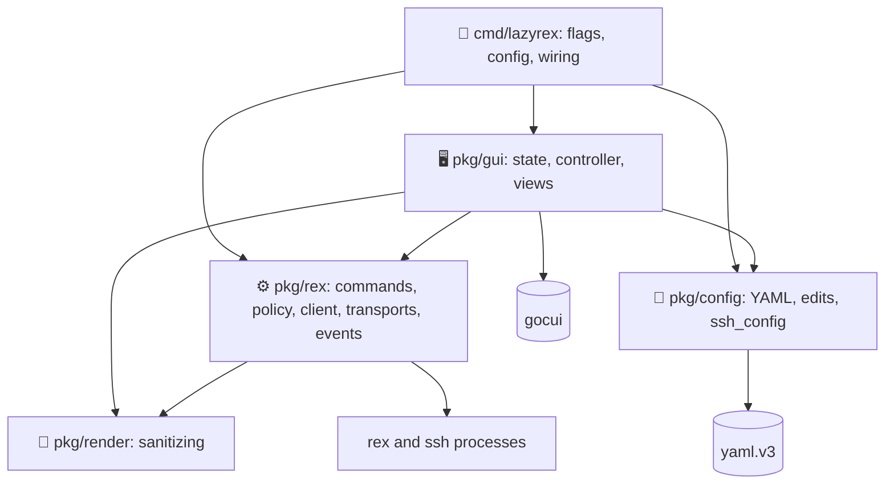
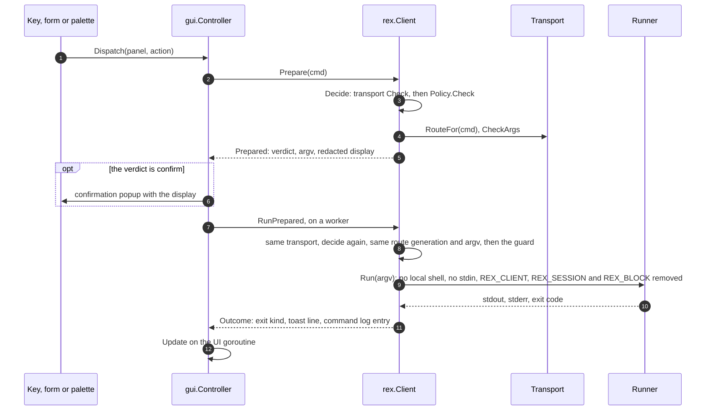
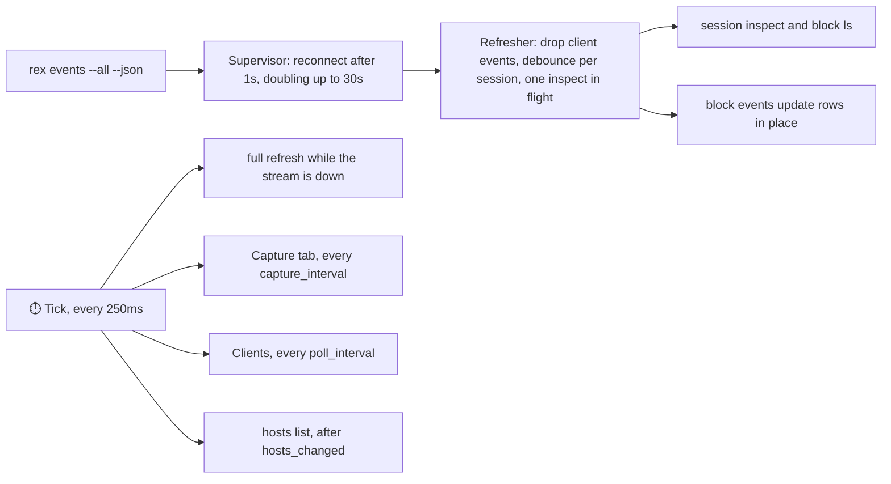

# Architecture

> **lazyrex is a small Go program in four packages: `pkg/rex` builds, checks and runs every `rex` and `ssh` call, `pkg/gui` owns the state and the gocui views, `pkg/config` reads and edits the config file, and `pkg/render` makes untrusted text safe to draw.** One UI goroutine owns the state; every call runs on a worker and lands back on it.

## Packages

| Package | Holds |
|---|---|
| [`cmd/lazyrex`](../cmd/lazyrex/main.go) | flag parsing, config loading, `--server` and `--ssh` resolution, key overrides, the policy from `$REX_BLOCK`, and the SSH environment; exit status 2 on any of them failing |
| `pkg/rex` | `Commands` (every invocation lazyrex makes), `Policy` (the safety layer), `Client` (prepare, confirm, run, log), transports, SSH probes and tunnels, the event `Supervisor` and `Refresher`, exit-code mapping, JSON parsers |
| `pkg/gui` | `State` (everything the views render), `Controller` (actions, refreshes, targets, config edits), the bindings, popups, layout, and the gocui app |
| `pkg/config` | the config file: defaults, validation, comment-keeping atomic edits of `targets`, and the `Host` names of `~/.ssh/config` |
| `pkg/render` | sanitizers for captures (colors kept), log text and one-line labels |
| `pkg/rex/rextest` | test doubles: a fake runner with canned responses and streams, and fixtures from `testdata/` |

## One UI goroutine

The `State` is touched only on the gocui goroutine. The `Controller` starts work with `Go` (a goroutine) and applies its result with `Update`, which runs queued functions in order. A ticker calls `Tick` every 250ms for the timed refreshes.

The active target is a **connection**: its client, a context cancelled when another target becomes active, its refresher and, for an SSH target, its link. A **target generation** changes when another target is activated, when another server instance is observed, and when the target leaves `online`. Work started on one generation drops its result, and a command built on it is refused, once the generation changed: that is the pinned target of [Safety](safety.md).

## A command's path

- [pkg/rex/commands.go](../pkg/rex/commands.go) builds each `Cmd`: its argv after the global flags, its kind (read, mutate, destroy, input, server start or stop, API), the blocks it touches, and what to redact.
- [pkg/rex/safety.go](../pkg/rex/safety.go) classifies it; [pkg/rex/client.go](../pkg/rex/client.go) adds `--autostart=false` (except `server start`) and `--timeout`, prepares the argv and display, and runs it at most `rex.timeout` plus 2s (plus 6s over ssh exec).
- The `ssh` probes and tunnel are not `rex` commands: [pkg/rex/sshlink.go](../pkg/rex/sshlink.go) runs them through `Client.runArgv` and `Client.streamArgv`, which skip `Prepare` and the global flags but use the same Runner and command log. Their argv comes from [pkg/rex/ssh.go](../pkg/rex/ssh.go): a destination checked when the target is built, fixed probe command lines, and an endpoint that `NormalizeEndpoint` accepted. Over ssh exec, the remote login shell parses the quoted words ([Safety](safety.md)).
- [pkg/rex/exitcode.go](../pkg/rex/exitcode.go) maps exit codes: 2 usage, 3 not found, 4 unreachable, 130 interrupted, 255 ssh on an SSH route, -1 start error ([Troubleshooting](troubleshooting.md)).

## Transports

| Transport | argv | Used for |
|---|---|---|
| `Local` | `rex GLOBALS ARGS` | the local target, and the home server's `version`, `hosts list` and `hosts check` |
| `Native` | `rex GLOBALS -S SERVER ARGS` | native targets |
| `SSHExec` | `ssh -o BatchMode=yes ... -- HOST 'REX' 'GLOBALS' 'ARGS'` | exec mode, the `whoami` that reads the remote endpoint, `server start` over ssh, inactive SSH rows |
| `SSHForward` | `rex GLOBALS -S unix://SOCKET ARGS` | forward mode, through the tunnel |
| `SSHLink` | a router: picks `SSHForward` or `SSHExec` per command | the active SSH target |

[pkg/rex/sshlink.go](../pkg/rex/sshlink.go) settles an SSH target's mode on each status read and keeps its tunnel up; every route change bumps a route generation, so a command confirmed on one route is refused on another ([SSH targets](ssh.md)).

## Events and refresh

- Updates come from `rex events --all --json`. Events of one session are debounced and trigger at most one `session inspect` at a time, only when the revision is newer. lazyrex's own client events are ignored (every `rex` call emits `client_*` events).
- When the stream ends, lazyrex reconnects with backoff (1s up to 30s) and polls every `refresh.poll_interval` meanwhile. A stream that comes back triggers a full refresh.
- The Capture tab refreshes every `refresh.capture_interval` and on the block's events while it is visible. The Clients panel refreshes every `refresh.poll_interval` while it is visible.
- A target's status is read one read at a time; a request meanwhile runs once that read ends.

## Untrusted text

Labels, titles, stderr, schemas and captures come from Rex and remote machines. [pkg/render/sanitize.go](../pkg/render/sanitize.go) has three modes: captures keep validated color sequences, `\n` and `\t`; log text keeps `\n` and `\t`; labels are one line. Every other escape sequence and control character is dropped before anything reaches a view.

## Seams for tests

`Runner` (run and stream an argv), `Clock` and `UI` are interfaces. Tests drive the real controller and client through `rextest.FakeRunner`, `rextest.FakeClock` and an inline or queued UI, and the gocui app runs headless. How to run them: [Development](development.md).
