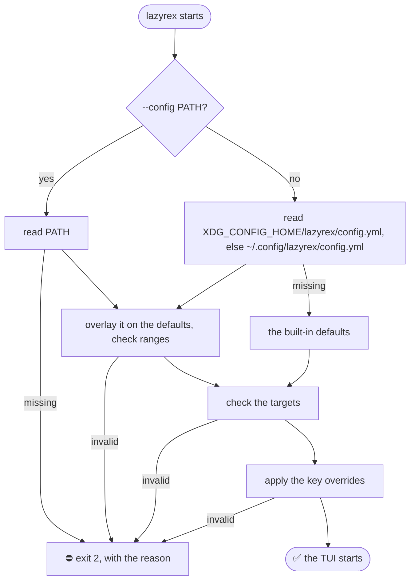

# Configuration

> **One optional YAML file sets the `rex` binary and timeout, refresh intervals, capture size, the safety allow-list, key overrides and your targets; every key has a default.** lazyrex reads it once at start, and edits only its `targets` list from the UI.

## Where it is



The default path is `$XDG_CONFIG_HOME/lazyrex/config.yml`, else `~/.config/lazyrex/config.yml`. A missing default file means defaults; a missing `--config` file is an error. Copy [config.example.yml](../config.example.yml), which lists every key with its default, to start one.

Every key is optional. Keys lazyrex does not know are ignored, and kept when lazyrex edits the file.

## Every key

| Key | Default | Meaning |
|---|---|---|
| `rex.binary` | `rex` | the `rex` binary, looked up in `PATH` unless absolute; not empty |
| `rex.timeout` | `10s` | the `--timeout` of every `rex` command (the `ssh` probes time out after it plus 8s); event streams are not limited by it. Positive |
| `refresh.poll_interval` | `5s` | full refresh while no event stream is up, and the Clients panel timer. Positive |
| `refresh.capture_interval` | `1s` | Capture tab refresh while it is visible. Positive |
| `refresh.debounce` | `200ms` | events of one session within this window cause a single inspect. Positive |
| `capture.max_lines` | `5000` | lines of scrollback kept for the Capture tab, from 1 to 1000000 |
| `capture.format` | `vt` | `vt` keeps colors, `text` is plain; lazyrex falls back to `text` for good if `rex` rejects `vt` |
| `safety.allow_actions` | `[]` | exact update or install action names to let through to the confirmation prompt (such as `checkForUpdates`), from the palette, `x` menus and Clients `a`; host, pairing, listener and Tailscale operations are always denied, even when listed here |
| `keybindings` | `{}` | key overrides: panel, then action name, then a key or a list of keys ([Keys](keys.md)) |
| `targets` | `[]` | targets listed besides the local server and the discovered hosts (below) |

Durations are written like `10s`, `200ms` or `1m`. lazyrex waits for a call up to `rex.timeout` plus 2s, and 6s more over ssh exec for the connection.

## Targets

```yaml
targets:
  - name: studio
    kind: native
    server: studio
  - name: lab
    kind: native
    server: 10.0.0.5:7297
  - name: home
    kind: local
  - name: edge
    kind: ssh
    ssh_host: user@remote-host
    mode: forward
    rex_path: /usr/local/bin/rex
```

| Field | `kind: local` | `kind: native` | `kind: ssh` |
|---|---|---|---|
| `name` | optional: renames the local target | required | required |
| `server` | none | required: a `rex hosts` label, a `host:port` or an `http(s)` URL, passed as `rex -S SERVER` | none |
| `ssh_host` | none | none | required: a `Host` of `~/.ssh/config` or `user@host`, with no leading `-` and no whitespace |
| `mode` | none | none | `forward` (default) or `exec` |
| `rex_path` | none | none | optional absolute path of the remote `rex`; skips probing for it |

- `kind` is required. At most one entry is `kind: local`.
- Names are unique, ignoring case, at most 64 characters, and `local` belongs to the built-in local target.
- A `server` is refused when it is empty, starts with `-`, has outer whitespace or control characters, or is over 255 bytes.

How each kind is reached: [Targets](targets.md) and [SSH targets](ssh.md).

## Editing from the UI

`a`, `e` and `d` on the Targets panel add, change and remove `targets` entries ([Targets](targets.md)). Every edit:

- changes only the `targets` list, keeping the file's comments and other keys (a flow-style list is rewritten in block style);
- is refused if the file changed on disk since lazyrex loaded it, or if the result would not load;
- replaces the file atomically, through its symlink if it is one, keeping its mode; a new file gets mode 0600, and a missing directory is created with mode 0700;
- asks you to edit the file by hand when `targets` is an alias, an anchor or not a list, or when the top level is not a mapping.

A failed edit says `config not changed: REASON` and leaves the file as it was. lazyrex never re-reads the file otherwise: change other keys by hand, then restart it.
