# Development

> **Build to `/tmp`, test against a fake runner, and touch the real Rex only through an opt-in, read-only smoke test.** Changes are planned, written and reviewed by agents of several model families inside a harness that scripts check.

## The loop

```mermaid
flowchart LR
    change["✏️ a change"] --> unit["go test ./...: fake runner, no real rex"]
    unit --> race["go test -race ./..."]
    race --> smoke["opt-in smoke test: read-only, local rex"]
    smoke --> review["🧐 harness: plan, tests first, critics, gate"]
    classDef entry fill:#bfdbfe,stroke:#1d4ed8,color:#0f172a
    classDef step fill:#e2e8f0,stroke:#475569,color:#0f172a
    classDef decision fill:#fde68a,stroke:#b45309,color:#1c1917
    classDef caution fill:#fed7aa,stroke:#c2410c,color:#1c1917
    classDef success fill:#bbf7d0,stroke:#15803d,color:#052e16
    classDef failure fill:#fecaca,stroke:#b91c1c,color:#450a0a
    classDef rexside fill:#99f6e4,stroke:#0f766e,color:#042f2e
    class change entry
    class unit,race,review step
    class smoke rexside
```



## Build

lazyrex needs Go 1.26. In this repository, Go and `gofmt` run through mise:

```sh
mise exec go@1.26 -- go build -o /tmp/lazyrex ./cmd/lazyrex
mise exec go@1.26 -- go build -ldflags "-X main.version=v1.2.3" -o /tmp/lazyrex ./cmd/lazyrex
```

Build to `/tmp`, never into the repository. Without `-ldflags`, `lazyrex --version` prints the module version of a `go install`, else `dev`. Release binaries set `main.version` to their tag (see Releases below).

## Tests

```sh
mise exec go@1.26 -- go test ./...
mise exec go@1.26 -- go test -race ./...
LAZYREX_SMOKE=1 mise exec go@1.26 -- go test -tags smoke ./pkg/rex/...   # read-only calls against the real rex
```

Agents must use the mise form ([AGENTS.md](../AGENTS.md)); with Go 1.26 in `PATH`, plain `go` works the same.

- Unit tests never run the real `rex` or `ssh`: they drive the real controller and client through `rextest.FakeRunner`, which answers each argv with canned output, often a fixture from `testdata/`, a fake clock, and a headless gocui ([Architecture](architecture.md)).
- The smoke test is opt-in (`-tags smoke` and `LAZYREX_SMOKE=1`). It runs `/usr/local/bin/rex`, else the `rex` in `PATH`, and only reads: `version`, `whoami`, `ls`, `server status`, `hosts list`, then `session inspect` and `block ls` of each session through the strict readers lazyrex uses before a kill. It checks that every argv carries `--autostart=false` and never `-S` or `hosts check`, accepts a stopped server, and skips when `rex` is not installed.

## CI

[The `ci` workflow](../.github/workflows/ci.yml) runs on every push to `main` and every pull request, in four jobs:

- `test`, on Ubuntu and macOS: `gofmt -l`, `go mod verify`, `go mod tidy -diff`, `go vet ./...` with and without `-tags smoke`, `go test ./...` and `go test -race ./...`. The smoke tag is only type-checked: CI never runs the smoke test. The tests of the release scripts in `tools/workflows` need GNU tar and coreutils `sha256sum`, so they skip on macOS and run on Ubuntu only.
- `cross` vets every target with cgo off: `linux/amd64`, `linux/arm64`, `darwin/amd64`, `darwin/arm64` and `windows/amd64`.
- `harness` runs `scripts/harness.sh check` and `scripts/test/harness.sh`.
- `lint` checks the workflows with actionlint, run through `go run` at the version pinned in [`ci.yml`](../.github/workflows/ci.yml). That compiles and runs actionlint's code on every run. The Go checksum database guarantees every run gets the same code, not that its publisher is trustworthy. It runs with read-only permissions and no secrets.

A release runs the same workflow again on the commit it builds.

## Releases

[The `release` workflow](../.github/workflows/release.yml) publishes the binaries of a pushed tag. A tag is `vMAJOR.MINOR.PATCH`, or `vMAJOR.MINOR.PATCH-rc.N` for a pre-release, never marked latest: no leading zeros, and N starts at 1.

Before tagging, CI must be green on the `main` commit to release, and the repository must stay public: the publish job reads the tag without credentials and refuses when it cannot. Only the human tags, one tag per push (GitHub creates no event when more than three tags are pushed at once):

```sh
git tag -a v0.1.0 -m v0.1.0 <main sha>
git push origin v0.1.0
```

The workflow then:

1. checks that the tag names the pushed commit and that this commit is on `main`;
2. runs the `ci` workflow again on that commit;
3. builds the binaries from that commit, with the Go version of `go.mod`;
4. publishes them.

The publish job first creates a draft holding the four archives and `SHA256SUMS`. It then checks that the draft holds exactly those files, each uploaded, with the local size and the local SHA-256: from GitHub's digest when the API gives one, or else by downloading the asset and hashing it. It checks the tag again, and only then publishes the draft. When a check fails, the job names the draft's id and leaves it unpublished: delete it, then run the job again.

**Residual risk, accepted, now closed.** The publish job checks the tag just before it publishes the verified draft, and again just after. In the few seconds between that last check and the publication, an account that can push could once move the tag. The release would then hold the verified commit's binaries under a tag that names another commit, and the job would fail red with the release still public. The human accepted this risk, then closed it with a tag ruleset: a pushed `v*` tag can no longer be moved or deleted. Agents change no repository setting unless the human asks in that session.

The archives are `lazyrex_<version>_<os>_<arch>.tar.gz`, where the version is the tag without its `v`, for `linux` and `darwin` on `amd64` and `arm64`. Each holds a directory of the same name with `lazyrex`, `LICENSE` and `README.md`. `SHA256SUMS` lists the four archives. There is no Windows binary: SSH targets are not available there ([SSH targets](ssh.md)).

A release of the tag that already exists, draft or published, makes the job fail and replaces nothing, so running it again after a success fails too. Never move, delete or push a tag again: fix forward with the next version. The tag ruleset refuses a move or a deletion anyway.

To reproduce a binary, run the build command of the release notes on the tagged commit, with the Go version they name, and compare the binaries, not the gzip files.

Repository settings the human has set:

- the tag ruleset "release tags" on `refs/tags/v*` blocks updates and deletions, with no bypass, not even for admins. It does not restrict creation: any account with push access can still create a new `v*` tag;
- the fork pull request approval policy is "all outside contributors": CI waits for approval from someone with write access before it runs on a pull request from any outside contributor.

Not enabled: immutable releases, and CI as a required check.

## Working against Rex

[AGENTS.md](../AGENTS.md) holds the rules every agent follows here, and they are good habits for humans too:

- every `rex` command starts with `rex --autostart=false`, except a `rex server start` you mean;
- against the real Rex, only read metadata (`--help`, `api describe`, `version`, `whoami`, `ls`, `server status`, `hosts list`, `session inspect`, `block ls`, and the smoke test);
- never send input to, close or kill a block, window or session you did not create, and never steal focus: `--focus=false`, full IDs;
- never change hosts, listeners, anonymous access or Tailscale settings, and never contact a remote host from tests or scripts.

## The multi-agent harness

Any change beyond a trivial one-liner follows the `multi-agent` skill ([.agents/skills/multi-agent/SKILL.md](../.agents/skills/multi-agent/SKILL.md)): `scripts/harness.sh` starts a run, prints which roles and models plan, attack the plan, implement (acceptance tests first, then frozen) and review it, with every critic from another model family than the Implementer, and `scripts/harness.sh gate` must pass before the work is called done. Models, roles and budgets live in `.agents/harness/*.tsv`; after a change to the harness, `scripts/harness.sh check` and `scripts/test/harness.sh` must pass. The rules: [AGENTS.md](../AGENTS.md).

## The wiki

The [wiki](https://github.com/rbobillot/lazyrex/wiki) is generated from `docs/` by [the `wiki` workflow](../.github/workflows/wiki.yml) on every push to `main`, daily and on demand. **Never edit the wiki**: the next run overwrites or removes any page edited or created there, and the wiki history keeps what it replaced. Each page opens with a banner naming its source commit. Pull requests render it too, so a broken link fails before merge. Check the committed docs locally with `mise exec go@1.26 -- go run ./tools/wikisync`, or write the pages with `-out /tmp/wiki` (an absent or empty directory). In `docs/`, use inline relative links to tracked files, fences at the start of the line, code spans on one line, no indentation of 4 or more outside fences, and a plain-text `# ` title. The [renderer](../tools/wikisync) refuses reference links, link titles, `<a>`/`` links, absolute paths and anything it does not parse.

## Contributing

- Write the tests first for a behavior change, then the code, in small Conventional Commits (`feat:`, `fix:`, `docs:`, `test:`...).
- Commits carry no tool-attribution trailers (`Co-authored-by` naming a tool, `Generated-with`).
- Format with `gofmt` and keep `go test ./...` green.
- Keep these docs in step with the code: every key, flag, default and message here comes from it.
