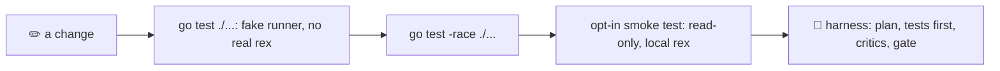

# Development

> **Build to `/tmp`, test against a fake runner, and touch the real Rex only through an opt-in, read-only smoke test.** Changes are planned, written and reviewed by agents of several model families inside a harness that scripts check.

## The loop



## Build

lazyrex needs Go 1.26. In this repository, Go and `gofmt` run through mise:

```sh
mise exec go@1.26 -- go build -o /tmp/lazyrex ./cmd/lazyrex
mise exec go@1.26 -- go build -ldflags "-X main.version=v1.2.3" -o /tmp/lazyrex ./cmd/lazyrex
```

Build to `/tmp`, never into the repository. Without `-ldflags`, `lazyrex --version` prints the module version of a `go install`, else `dev`.

## Tests

```sh
mise exec go@1.26 -- go test ./...
mise exec go@1.26 -- go test -race ./...
LAZYREX_SMOKE=1 mise exec go@1.26 -- go test -tags smoke ./pkg/rex/...   # read-only calls against the real rex
```

Agents must use the mise form ([AGENTS.md](../AGENTS.md)); with Go 1.26 in `PATH`, plain `go` works the same.

- Unit tests never run the real `rex` or `ssh`: they drive the real controller and client through `rextest.FakeRunner`, which answers each argv with canned output, often a fixture from `testdata/`, a fake clock, and a headless gocui ([Architecture](architecture.md)).
- The smoke test is opt-in (`-tags smoke` and `LAZYREX_SMOKE=1`). It runs `/usr/local/bin/rex`, else the `rex` in `PATH`, and only reads: `version`, `whoami`, `ls`, `server status`, `hosts list`, then `session inspect` and `block ls` of each session through the strict readers lazyrex uses before a kill. It checks that every argv carries `--autostart=false` and never `-S` or `hosts check`, accepts a stopped server, and skips when `rex` is not installed.

## Working against Rex

[AGENTS.md](../AGENTS.md) holds the rules every agent follows here, and they are good habits for humans too:

- every `rex` command starts with `rex --autostart=false`, except a `rex server start` you mean;
- against the real Rex, only read metadata (`--help`, `api describe`, `version`, `whoami`, `ls`, `server status`, `hosts list`, `session inspect`, `block ls`, and the smoke test);
- never send input to, close or kill a block, window or session you did not create, and never steal focus: `--focus=false`, full IDs;
- never change hosts, listeners, anonymous access or Tailscale settings, and never contact a remote host from tests or scripts.

## The multi-agent harness

Any change beyond a trivial one-liner follows the `multi-agent` skill ([.agents/skills/multi-agent/SKILL.md](../.agents/skills/multi-agent/SKILL.md)): `scripts/harness.sh` starts a run, prints which roles and models plan, attack the plan, implement (acceptance tests first, then frozen) and review it, with every critic from another model family than the Implementer, and `scripts/harness.sh gate` must pass before the work is called done. Models, roles and budgets live in `.agents/harness/*.tsv`; after a change to the harness, `scripts/harness.sh check` and `scripts/test/harness.sh` must pass. The rules: [AGENTS.md](../AGENTS.md).

## The wiki

The [wiki](https://github.com/rbobillot/lazyrex/wiki) is generated from `docs/` by [the `wiki` workflow](../.github/workflows/wiki.yml) on every push to `main`, daily and on demand. **Never edit the wiki**: the next run overwrites or removes any page edited or created there, and the wiki history keeps what it replaced. Each page opens with a banner naming its source commit. Pull requests render it too, so a broken link fails before merge. Check the committed docs locally with `mise exec go@1.26 -- go run ./tools/wikisync`, or write the pages with `-out /tmp/wiki` (an absent or empty directory). In `docs/`, use inline relative links to tracked files, fences at the start of the line, code spans on one line, no indentation of 4 or more outside fences, and a plain-text `# ` title. The [renderer](../tools/wikisync) refuses reference links, link titles, `<a>`/`` links, absolute paths and anything it does not parse.

## Contributing

- Write the tests first for a behavior change, then the code, in small Conventional Commits (`feat:`, `fix:`, `docs:`, `test:`...).
- Commits carry no tool-attribution trailers (`Co-authored-by` naming a tool, `Generated-with`).
- Format with `gofmt` and keep `go test ./...` green.
- Keep these docs in step with the code: every key, flag, default and message here comes from it.
