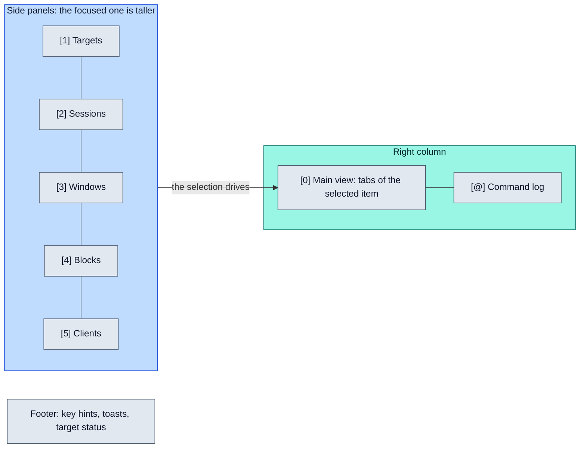

# Getting started

> **Install lazyrex, run it against your local Rex server, and learn its screen: five side panels on the left, the selected item in the main view, every command in the log.** Ten minutes here and every other page is a reference.

## Install

lazyrex needs `rex` (API revision 9) in `PATH` to run, and Go 1.26 only to build it from source. SSH targets also need OpenSSH's `ssh` in `PATH` and `$XDG_RUNTIME_DIR` set to a private directory: a clean absolute path, yours, mode 0700, no symlinks, short enough for socket paths. Without it, or on Windows, SSH targets are listed but say why they are not available ([SSH targets](ssh.md)).

Binaries for Linux and macOS, on amd64 and arm64, are on the [latest release](https://github.com/rbobillot/lazyrex/releases/latest):

```sh
v=0.1.0 os=linux arch=amd64   # os: linux or darwin; arch: amd64 or arm64
base=https://github.com/rbobillot/lazyrex/releases/download/v$v
curl -LO "$base/lazyrex_${v}_${os}_${arch}.tar.gz" -LO "$base/SHA256SUMS"
grep " lazyrex_${v}_${os}_${arch}.tar.gz\$" SHA256SUMS | sha256sum --check   # macOS: shasum -a 256 --check
tar -xzf "lazyrex_${v}_${os}_${arch}.tar.gz"
mkdir -p ~/.local/bin
install "lazyrex_${v}_${os}_${arch}/lazyrex" ~/.local/bin/
```

The macOS binaries are unsigned: one downloaded with a browser needs `xattr -d com.apple.quarantine` before it runs. Or, with Go 1.26:

```sh
go install github.com/rbobillot/lazyrex/cmd/lazyrex@latest
# or, from a checkout:
go build -o /tmp/lazyrex ./cmd/lazyrex
lazyrex --version
```

## Run it

```sh
lazyrex [--server|-S TARGET | --ssh HOST] [--config PATH] [--version]
```

| Flag | Meaning |
|---|---|
| `--server TARGET`, `-S TARGET` | start on TARGET: a config target name, `local`, or anything else as an ad-hoc native target reached through `rex -S TARGET` (a `rex hosts` label, `host:port` or URL) |
| `--ssh HOST` | start on the SSH target reaching HOST, a `Host` of `~/.ssh/config` or `user@host`: the first config SSH target whose `ssh_host` is exactly HOST, else a new ad-hoc SSH target named HOST, in forward mode (refused if another target already has that name). It cannot be combined with `--server`. |
| `--config PATH` | config file; default `$XDG_CONFIG_HOME/lazyrex/config.yml`, else `~/.config/lazyrex/config.yml`. A missing default file means defaults; a missing `--config` file is an error. |
| `--version` | print the version and exit |

A bad config, a key bound twice in one panel, or a server or SSH destination lazyrex refuses exits with status 2 and says why. How targets are chosen: [Targets](targets.md). Every config key: [Configuration](configuration.md).

On start, lazyrex reads `rex version` and `rex hosts list` from the local server, then the active target's `whoami` and `server status`, its sessions and its clients, and subscribes to `rex events --all --json`. Every `rex` command but `server start` passes `--autostart=false`, so a stopped local server stays stopped: that is normal (it exits when its last session ends) and never reported as an error. Press `s` on the Targets panel to start it, after confirming the exact command.

## The screen



- **[1] Targets**: the targets ([Targets](targets.md)), `*` on the active one, with its transport, status (`online`, `stopped`, `unreachable`, `unreachable (ssh)` when ssh itself failed, `online, api mismatch` when the server's `api_revision` is not 9, or `error`) and session count. Main tabs: **Status** (`whoami` and `server status`, discovered host details and `rex hosts check` results) and **Keymap & Actions** (`rex keymap --json` and `rex actions --json`, each action tagged `[allowed]`, `[confirm]` or `[denied]` by the safety layer; read only for the active target).
- **[2] Sessions**: label, window count, block count. Main tab: **Inspect** (a summary, then the raw `session inspect` JSON).
- **[3] Windows**: windows of the selected session, or of every session; label, block count, `*` on the active one. Main tab: **Inspect**.
- **[4] Blocks**: blocks of the selected window, session, or of every session (the panel's subtitle says which); label, creator, state, last exit, program status, title, `bell`, `detached`, and `self` on lazyrex's own block. Main tabs: **Capture** and **Inspect** (`block inspect`, `process`, `modes`).
- **[5] Clients**: kind, name, platform, version and connection state. CLI clients (every `rex` call is one) are hidden until you press `A`. Main tabs: **Inspect** (`client inspect`) and **Actions** (`rex -C CLIENT actions --json`, tagged like server actions).
- **Command log**: every command run, with its duration, exit code and full stderr, plus refusals and notes.
- **Footer**: key hints for the focused panel, toasts, and the target's status.

The **Capture** tab runs `rex capture -s SESSION -b BLOCK --format=vt` (falling back to `--format=text` for good if `vt` is rejected), keeps the last `capture.max_lines` lines, and strips every escape sequence except colors. Full-screen programs have no scrollback; the tab then says it shows the current screen.

## Moving around

- `1` to `5` jump to a side panel, `0` to the main view, `@` to the command log; `tab` / `l` and `shift+tab` / `h` cycle the side panels.
- `j` / `k` move in a list and scroll the main view and the log; `<` / `>` go to the top and bottom, `,` / `.` page.
- `[` / `]` switch the main view's tab. `K` / `J` and `pgup` / `pgdn` scroll the main view while a side panel keeps focus.
- `/` filters the focused side panel, or searches the main view (then `n` / `N` jump between matches); `esc` clears it.
- `enter` on Sessions scopes Windows and Blocks to that session; on Windows it scopes Blocks to that window. `A` on Windows or Blocks lists those of every session.
- `?` lists the keys of the focused panel, and `enter` there runs the selected one. `x` lists its actions by name.
- `R` refreshes everything now; `q` or `ctrl+c` quits.

All keys: [Keys](keys.md).

## First actions

Every action below goes through the safety policy: destructive ones show the exact command and wait for `y` or `enter` ([Safety](safety.md)).

1. On **Sessions**, `n` creates a session: a name and a working directory (an absolute path), both optional.
2. On **Windows**, `n` adds a window to the selected session; `f` focuses it in your Rex app.
3. On **Blocks**, `|` and `-` split the selected block right and below; `n` asks for a direction, a command, a label and a ratio.
4. Still on **Blocks**, `i` sends text without Enter, `I` sends it then Enter, and `p` presses one key. `enter` shows the Capture tab, which follows the block as it changes.
5. `d` kills a session, closes a window or closes a block, after confirmation.
6. `:` opens the command palette for `api call` and `do`, and `x` on Targets runs a server action ([Actions](actions.md)).

## Where next

- [Targets](targets.md) to add native hosts and SSH targets.
- [Keys](keys.md) to rebind anything.
- [Troubleshooting](troubleshooting.md) when a status or a toast surprises you.
