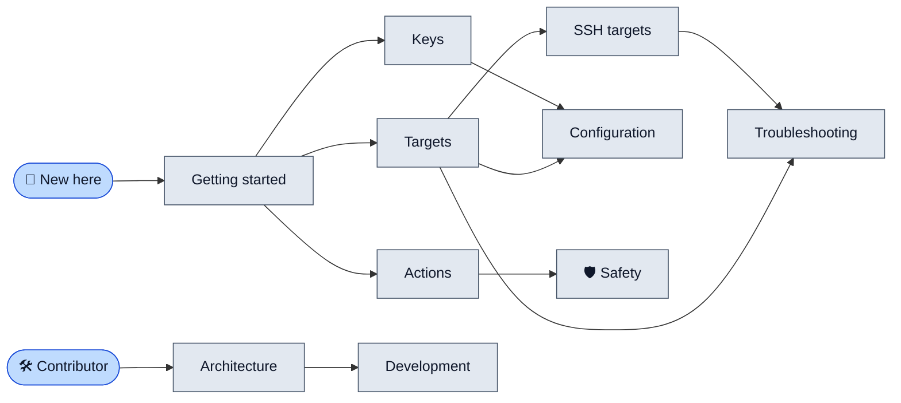

# lazyrex documentation

> **lazyrex is a terminal UI for the Rex multiplexer, in the style of lazygit and lazydocker.** It shows the sessions, windows, blocks and clients of the local Rex server, of native hosts and of Rex servers over SSH, runs every command through one safety policy, and logs each one. Start with Getting started, then pick the page you need.

## The map

## Pick your page

| If you want to... | Read |
|---|---|
| Install lazyrex, run it, and learn the screen | [Getting started](getting-started.md) |
| Reach another Rex server: a native host, `--server`, `--ssh` | [Targets](targets.md) |
| Reach Rex on another machine through `ssh` | [SSH targets](ssh.md) |
| Look up a key, or bind your own | [Keys](keys.md) |
| Run server and client actions, resize panes, use the `:` palette | [Actions](actions.md) |
| Know what lazyrex refuses, asks about and hides | [Safety](safety.md) |
| Change timeouts, refresh intervals, capture size or targets | [Configuration](configuration.md) |
| Understand a status, an error or an exit code | [Troubleshooting](troubleshooting.md) |
| See how the code is laid out | [Architecture](architecture.md) |
| Build, test, release and contribute | [Development](development.md) |

## Where things live

| What | Where |
|---|---|
| The project overview | [README](../README.md) |
| A commented config file with every default | [config.example.yml](../config.example.yml) |
| Rules for coding agents | [AGENTS.md](../AGENTS.md) |
| The license | [Apache-2.0](../LICENSE) |

These pages are plain Markdown under `docs/` with relative links, mirrored to the [wiki](https://github.com/rbobillot/lazyrex/wiki) by CI: to change one, edit its source there, never the wiki.
