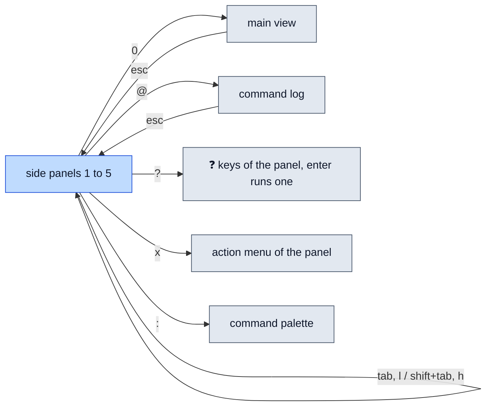

# Keys

> **Every key lazyrex binds, the name you rebind it by, and how popups read keys.** `?` shows the keys of the focused panel at any time, and `enter` there runs the selected one, so this page is for looking things up and for writing overrides.

## Getting around



Keys of the **Every panel** table work everywhere, the command log included; `?` lists a panel's own keys first. The main view and the command log show the `x` menu of the side panel behind them.

## Every panel

The panel of these names is `universal`.

| Key | Action | Name |
|---|---|---|
| `q`, `ctrl+c` | quit | `quit` |
| `esc` | close popup, clear filter or search, go back | `back` |
| `?` | keybindings help | `help` |
| `x` | action menu of the focused panel | `menu` |
| `:` | command palette | `palette` |
| `/` | filter the side panel, or search the main view | `filter` |
| `@` | focus the command log | `commandLog` |
| `1`–`5` | jump to a side panel | `jump1`–`jump5` |
| `0` | focus the main view | `jumpMain` |
| `tab`, `l`, right | next panel | `nextPanel` |
| `shift+tab`, `h`, left | previous panel | `prevPanel` |
| `j`, down / `k`, up | move down / up (scroll in the main view and log) | `down` / `up` |
| `<` / `>` | top / bottom | `top` / `bottom` |
| `,` / `.` | page up / down | `pageUp` / `pageDown` |
| `[` / `]` | previous / next main tab | `prevTab` / `nextTab` |
| `pgup`, `ctrl+u` / `pgdn`, `ctrl+d` | scroll the main view a page | `scrollPageUp` / `scrollPageDown` |
| `K` / `J` | scroll the main view a line | `scrollUp` / `scrollDown` |
| `R` | refresh now | `refresh` |

## Per panel

| Panel | Key | Action | Name |
|---|---|---|---|
| `targets` | `enter`, `space` | activate the selected target; on the active one, re-read everything | `activate` |
| | `s` | start server (confirm; active local or SSH target) | `startServer` |
| | `S` | stop server (confirm; active target only) | `stopServer` |
| | `c` | check reachability: re-read the active target, or probe an inactive one; SSH targets are probed again | `checkTarget` |
| | `a` | add a config target, native or SSH | `addTarget` |
| | `e` | edit a config target | `editTarget` |
| | `d` | remove a config target (confirm) | `removeTarget` |
| `sessions` | `enter` | scope Windows and Blocks to it | `scope` |
| | `n` | new session (name, working directory) | `newSession` |
| | `r` | rename | `renameSession` |
| | `d` | kill (confirm) | `killSession` |
| | `o` | show it in a Rex app | `showInApp` |
| `windows` | `enter` | scope Blocks to it | `scope` |
| | `A` | windows of all sessions | `toggleAll` |
| | `f` | focus | `focusWindow` |
| | `n` | new window | `newWindow` |
| | `r` | rename | `renameWindow` |
| | `d` | close (confirm) | `closeWindow` |
| `blocks` | `enter` | show the Capture tab | `showCapture` |
| | `A` | blocks of all sessions | `toggleAll` |
| | `f` | focus | `focusBlock` |
| | `z` | zoom toggle | `toggleZoom` |
| | `n` | new pane: direction, command, label, ratio | `newPane` |
| | `\|` / `-` | split right / below | `splitRight` / `splitBelow` |
| | `i` | send text (no Enter) | `sendText` |
| | `I` | send text, then Enter | `sendTextEnter` |
| | `p` | press a key (`enter`, `tab`, `esc`, arrows, `ctrl+c`, `ctrl+d`, `ctrl+\`, `ctrl+z`, or any key name) | `pressKey` |
| | `r` | rename | `renameBlock` |
| | `d` | close (confirm) | `closeBlock` |
| `clients` | `enter` | show the Inspect tab | `showInspect` |
| | `A` | show CLI clients | `toggleCLI` |
| | `a` | run a client action | `runClientAction` |
| `main` | `n` / `N` | next / previous search match | `nextMatch` / `prevMatch` |

`s` is not offered on a native row, so it is missing from the footer, `?` and `x` there. What each action does: [Actions](actions.md).

## Popups

In popups: `enter` accepts and `esc` cancels; `ctrl+c` quits from every popup, `q` from all but text prompts, where it is typed; `j`/`k` move in menus; `y`/`n` answer confirmations; `tab` completes in the palette. A key is never sent to a block unless you pick it with `p`.

## Overriding keys

Override keys in the config file under `keybindings.<panel>.<name>`, with the names above. Panels are `universal`, `targets`, `sessions`, `windows`, `blocks`, `clients` and `main`. A value is one key or a list of keys, and it replaces every default key of that action:

```yaml
keybindings:
  universal:
    refresh: <c-r>
  blocks:
    sendText: t
    splitRight: ["|", v]
  sessions:
    showInApp: O
```

A key is one printable character, or one of `<enter>`, `<esc>`, `<tab>`, `<backtab>`, `<space>`, `<up>`, `<down>`, `<left>`, `<right>`, `<pgup>`, `<pgdown>`, `<home>`, `<end>`, `<c-a>` … `<c-z>`. `<c-h>`, `<c-i>` and `<c-m>` are refused: terminals send them as backspace, tab and enter.

These are errors, and lazyrex exits with status 2 on them:

- an unknown panel (`keybindings: unknown panel "x" (want one of universal, blocks, clients, main, sessions, targets, windows)`);
- an action of another panel (`keybindings.universal: sendText is not a universal action`) or an unknown one;
- an empty key list, or an invalid key;
- a key bound twice in one panel, counting the `universal` keys that apply there (`keybindings: key "t" is bound to both ... in the blocks panel`).

`scope` and `toggleAll` exist in two panels each: an override under `sessions` changes only the Sessions key. Every config key: [Configuration](configuration.md).
