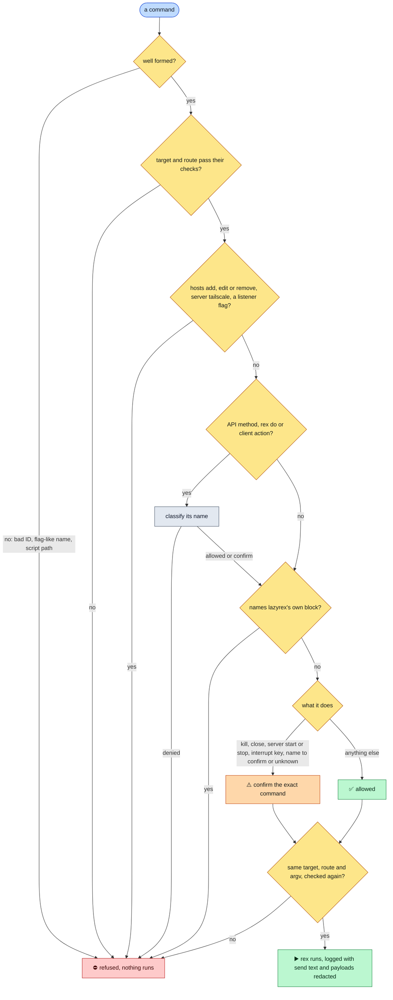
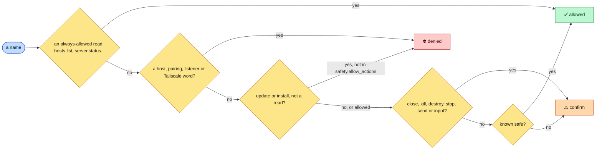

# Safety

> **One policy checks every `rex` command lazyrex runs, whether it comes from a key, an `x` menu, a form or the palette: some operations are always refused, destructive ones show the exact command first, nothing touches lazyrex's own block, and the text of `send` and the payloads of `api call` and `do` never reach the command log.** The `ssh` probes and tunnel of an SSH target are checked apart, and every other argument is logged as typed. This page lists every rule, so you know what a key can and cannot do before you press it.

## What lazyrex never does

- Start a server you did not ask for: every `rex` command passes `--timeout` and `--autostart=false`, except `server start`, which has no `--autostart=false` and runs only when you ask for it and confirm it.
- Change hosts, pairing, listeners or Tailscale settings, by any path, with one exception you confirm twice: `w` on Targets writes `lazyrex-hosts.lua` in Rex's config directory, declaring a host for the stable socket of each forward-mode SSH target, then runs `rex config reload` on this machine's server. Those hosts belong to this machine's server and never sync to your other devices. lazyrex never runs `rex hosts add`, `edit` or `remove`, and never edits `init.lua`: you add the line that loads the file. Details: [Rex app hosts file](#rex-app-hosts-file).
- Send input to or close the block it runs in, or kill or close the session or window that holds it.
- Steal focus from a Rex app: every new window and pane passes `--focus=false`; only `f` and `o` change what an app shows.
- Run a Lua script, or read a file or stdin, through `rex do`; or hand a local shell anything: every process runs from an argv.
- Edit `rex hosts`, Rex's `init.lua` or `~/.ssh/config`, or run a command to edit its own config file.

## How a command is classified

Names of API methods, `rex do` actions and client actions are split into words (on `.`, `_`, `-`, `/`, spaces and camelCase, so `checkForUpdates` holds `updates`) and classified:

The always-allowed reads are `hosts.list`, `server.status`, `server.version`, `server.whoami` and `server.apple.privacy_status`. The known safe names are `session.view`, `session.list`, `session.list_blocks`, `client.list`, `target.resolve`, `target.complete`, `session.new_split`, `session.new_window`, `session.new_block`, `session.resize_pane`, `session.float_block` and `session.select`. A name made only of `update` or `updates` and the words `status`, `available`, `info`, `get`, `list`, `show` or `version` (such as `updates.status`) is a read, not an update.

The `[allowed]`, `[confirm]` and `[denied]` tags of the Keymap & Actions and client Actions tabs are this classification.

## Confirmations

**Confirmation** shows the exact command before it runs: kill session, close window, close block, stop server, start server, the interrupt keys `ctrl+c`, `ctrl+d`, `ctrl+\` and `ctrl+z`, and any API method, server action or client action whose name closes, kills, destroys, stops or sends input (or is `server.config_reload`, as `rex config reload` is classified), or that lazyrex does not know. `y` or `enter` runs it, `n` or `esc` cancels. Removing a config target is confirmed too. Writing `lazyrex-hosts.lua` is confirmed too: the prompt shows its path and every `rex.host` line.

## Denied operations

- **Denied operations** are refused without a prompt: host (all but the reads `hosts list` and `hosts check`), pairing, listener, Tailscale and update or install operations, `rex hosts add|edit|remove`, `rex server tailscale`, and `rex server start` or `run` with `--extra-listen`, `--allow-anonymous` or `--tailscale`. `server.apple.grant_file_access` is denied too.
- `safety.allow_actions` can let a listed update or install action reach a confirmation prompt, but never a host, pairing, listener or Tailscale one. An entry it can never allow is ignored with a warning at start.
- **No scripts**: `rex do` runs a name with `/` or `\`, or ending in `.lua`, as a Lua script, and `-` from stdin. Such names are refused everywhere, as are argument keys starting with `@` or `-` and an `--args` that is not a JSON object.
- **Server actions only from the server's list**: a `rex do` from the palette or Targets `x` runs only if a fresh `rex actions --json` lists it. It is also refused when its dotted prefix (`pane.` in `pane.split`) starts an action of a connected Rex app, because `rex do` would send it to that app. That check reads `rex client ls --all --json` and each app's actions fresh, and refuses the call if any read fails. Both checks run before the confirmation and again right before the call, since the lists can change while it waits. Run client actions from Clients `a`, which, like `o`, checks right before the call that the client still offers the action.

## Own block

When lazyrex runs inside Rex, `$REX_BLOCK` names its own block, shown as `self` in the Blocks panel.

- Sending text or keys to it, closing it, and killing or closing the session or window that holds it are refused. Only a full block ID (`block:...`) counts; any other value is ignored with a warning in the command log.
- When it knows its own block, lazyrex re-reads `session inspect` (and `block ls` for a session) right before a kill or a window close, and refuses the call when they cannot be read.
- API calls and actions are refused when an argument names the own block. That includes its ID decoded from JSON escapes, any key or value at any depth, an ID suffix of 4 or more characters, and its current label, followed across refreshes.
- Arguments that name a block (`block`, `block_id`, `pane`, `pane_id`, `target`, `anchor`, and keys ending in `_block`, `_block_id`, `_pane` or `_pane_id`) must hold a full block ID other than lazyrex's own: a label, suffix or short ID there is refused, even when `$REX_BLOCK` is unset.

## Targets and transports

- **Native servers**: a `-S` value from the flag, the config or `rex hosts list` stays one argv element, never reaches a shell, and is refused when it is empty, starts with `-`, has outer whitespace or control characters, or is longer than 255 bytes; target names are at most 64 characters. A refused target makes no call.
- **SSH**: every `ssh` runs with `BatchMode=yes` and `--` right before the destination, which is refused when it is empty, starts with `-`, holds whitespace, control characters or invalid UTF-8, or is longer than 255 bytes; so is a `rex_path` that is not an absolute path. The forwarded endpoint must be a `unix://` absolute path whose decoded form holds no `:`, `%`, `${`, `\`, control character or whitespace other than a space (in `-L`, ssh expands `%` and `${`, drops `\` and splits on `:`), forwarded as one `-L` argument to a socket only lazyrex's user can reach; lazyrex opens no TCP listener. A confirmation shows the very argv that then runs: when the route changes in between (tunnel down, mode change), the command is refused instead. Details: [SSH targets](ssh.md).
- **The remote login shell**: ssh joins the words after the destination into one command line that the remote login shell parses. So over ssh exec each word of a `rex` command is single-quoted for a POSIX login shell, or must be a plain word (letters, digits and `._+@/=:,-`) for another one, and is refused otherwise.
- **SSH plumbing outside the policy**: the two probes and the `ssh -N` tunnel are not `rex` commands. They skip the policy and the `rex` global flags, and are built by lazyrex alone: a destination checked when the target is built, fixed probe command lines (`echo "$SHELL"`, then `command -v rex` with a list of known paths), and a tunnel from a socket in lazyrex's private runtime directory to an endpoint that passed the checks above. The probes time out after `rex.timeout` plus 8s, and both are logged like any call.
- **Files in the runtime directory**: lazyrex creates the stable `gui-NAME_HASH.sock` of a target and its `gui-NAME_HASH.lock` there without asking, and a short-lived `hosts-check-PID.lua` copy for `rex config check`, as it does its private sockets and ssh its control sockets; none of it lands on the remote machine. It removes a socket only when a dial to it is refused, so a socket another lazyrex serves stays. The lock is never deleted. Details: [SSH targets](ssh.md#forward-mode).
- **Pinned target**: a command runs only on the target and server instance lazyrex last observed when its selection was read: when you pressed the key, or opened the palette or a form that reads Rex first (resize, server and client actions, `o`). A result read after the target changed is dropped. A command is refused, with nothing run, once lazyrex has observed another server instance or the target going offline, or another target activated, since then. That is checked when the form completes and again right before the `rex` process starts, after any confirmation. A restart lazyrex has not observed yet (before the event stream drops or the next poll) is not detected.

## Rex app hosts file

`w` on Targets is the only way lazyrex changes what hosts a Rex server knows, and only on this machine:

- **Where**: `lazyrex-hosts.lua` in Rex's config directory, `$XDG_CONFIG_HOME/rex` when that is an absolute path, else `~/.config/rex`. `$REX_CONFIG` only changes which file Status names as the one that must load it.
- **Only its own file**: lazyrex writes it only when it is missing, or a regular file of yours that starts with lazyrex's exact header. It refuses a symlink, any other file, and a directory that is not yours or that others can write to.
- **Content**: one `rex.host` line per forward-mode SSH target of the config file, labeled `NAME-lazyrex` (letters, digits and `-` only, at most 63 bytes), with the target's stable socket as its endpoint. Both are quoted Lua literals, with any byte outside printable ASCII written as `\ddd`.
- **Checked first**: `rex config check --json` on a copy in the runtime directory must report no diagnostic at all before the confirmation shows.
- **Written safely**: lazyrex locks the directory, checks again that the file is still the one it read, writes a temporary file at 0600 and renames it over the file. It refuses when the file changed since it read it.
- **Local only**: `rex config reload`, `rex config check`, and any API method or action whose name holds `config` and `reload`, are refused unless they go to this machine's server with no `-S`. They run without `REX_SERVER`.

## Processes, logs and screens

- **No local shell**: every process, `rex` or `ssh`, runs from an argv, with no local shell and no stdin. Only the remote login shell of an SSH target parses a command line, as above.
- **Child environment**: `REX_CLIENT`, `REX_SESSION` and `REX_BLOCK` are removed from the environment of every process that lazyrex runs, so no call falls back to lazyrex's own pane, session or client. `REX_SERVER` is kept, except for local-only commands, which run without it.
- **Redaction**: the text of `send`, and everything after the method or action name of `api call`, `do` and `-C CLIENT do` (JSON, `--args`, and the values of `KEY=VALUE` pairs, whose keys stay visible), is shown as `<redacted N bytes>` in confirmations and in the command log, quoted or not inside an `ssh` argv. Nothing else is redacted: a new pane's command, labels, names, directories, servers, hosts and the `ssh` probes appear as typed, so keep secrets out of a pane command.
- **Sanitizing**: every displayed argv, stderr, title, label and schema text is stripped of escape sequences and control characters. Captures keep colors only.
- **IDs**: lazyrex names every session, window, block and client by its full ID, never by a label or the current one.

What a refusal looks like and what to do: [Troubleshooting](troubleshooting.md).
