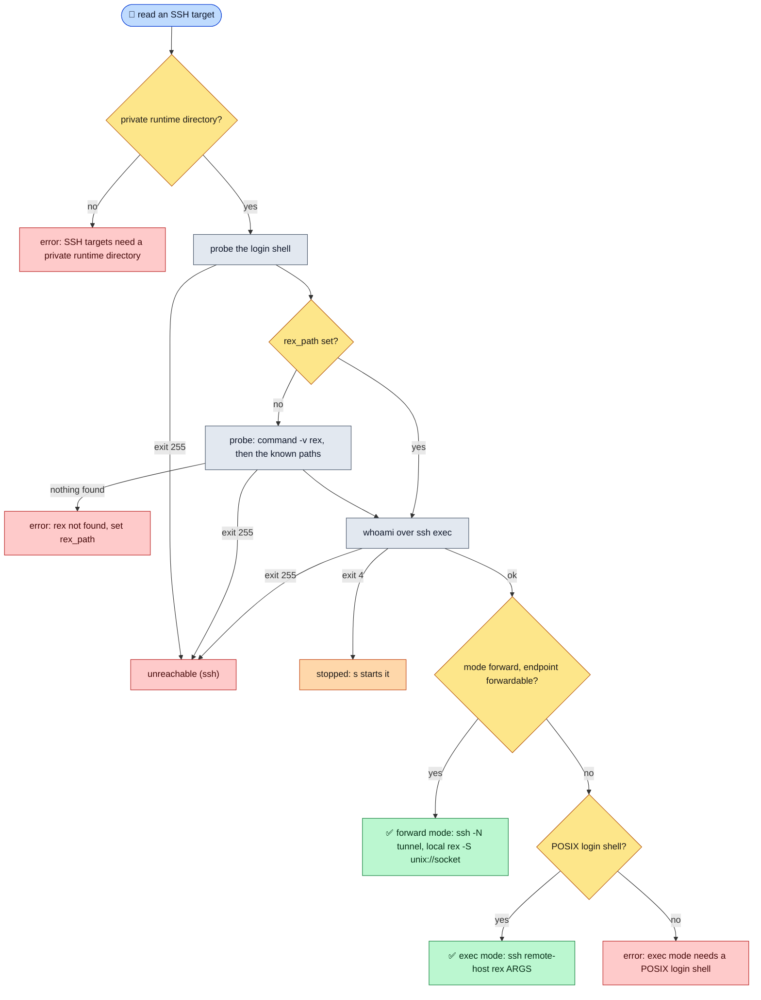
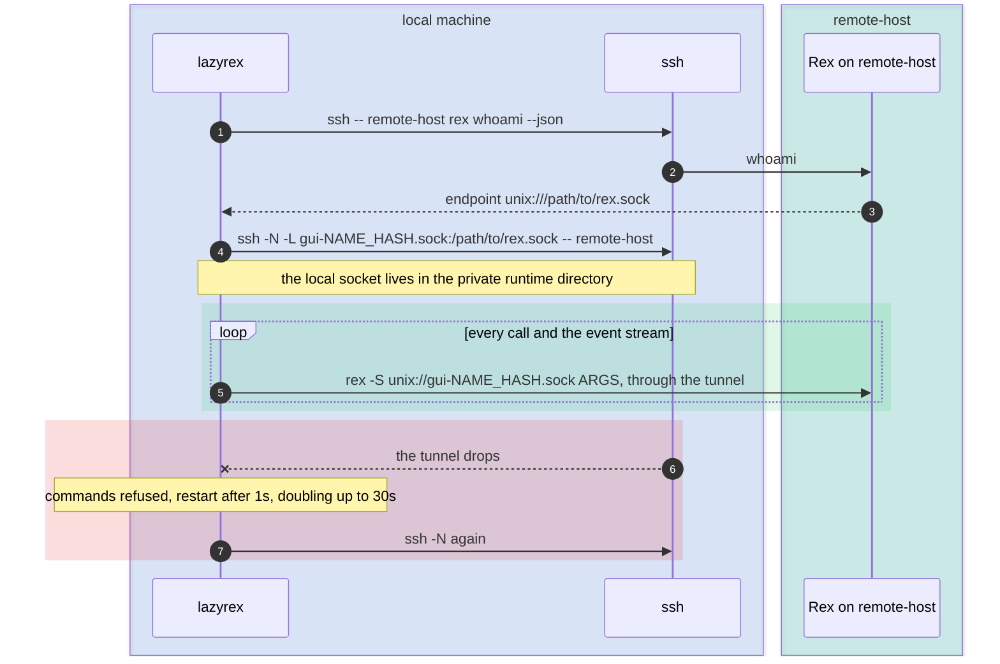

# SSH targets

> **An SSH target reaches Rex on another machine through your own `ssh`: lazyrex probes the remote shell and `rex` once, then either forwards the remote Rex socket through a tunnel (forward mode, the default) or runs the remote `rex` over ssh for every call (exec mode).** ssh never prompts, so keys, agent and `known_hosts` must be ready first.

## Before you start

- A `kind: ssh` target runs the remote `rex` through `ssh` to `ssh_host`, a `Host` of `~/.ssh/config` or `user@host`.
- Every `ssh` runs with `BatchMode=yes` and `ConnectTimeout=5`, so it never prompts for a password, passphrase or host key: set up keys, an agent and `known_hosts` first (`ssh remote-host` in a terminal).
- OpenSSH's `ssh` must be in `PATH`. lazyrex keeps its sockets in a private runtime directory, which must stay yours, mode 0700, with no symlinks:
  - when `$XDG_RUNTIME_DIR` is set, it must be a private directory (a clean absolute path, yours, mode 0700, no symlinks, short enough for socket paths) and lazyrex creates `$XDG_RUNTIME_DIR/lazyrex` in it. A set but invalid value is an error, never a fallback.
  - when it is unset (always on macOS, sometimes on Linux under `su`, `sudo`, cron or containers), lazyrex uses `/tmp/lazyrex-UID/run` (`/private/tmp/…` on macOS), creating both levels with mode 0700. `/tmp` must belong to root or you and be sticky (or closed to others).

  lazyrex checks the directory again, and recreates what is missing, for every SSH target it reads. On Windows, or when the directory fails its checks, SSH targets are listed but say why they are not available.

```yaml
targets:
  - name: edge
    kind: ssh
    ssh_host: user@remote-host
    mode: forward              # the default; or exec
    rex_path: /usr/local/bin/rex   # optional: skips the rex probe
```

Or, without a config entry: `lazyrex --ssh user@remote-host`.

## From probe to mode



**Probes**: once per target (and per `rex_path`), lazyrex reads the remote login shell (`echo "$SHELL"`) and, unless `rex_path` is set, looks for `rex` (`command -v rex`, else whichever of `/usr/local/bin/rex`, `/opt/homebrew/bin/rex`, the Rex.app binary and the Rex Beta.app one exists, preferred in that order). The Rex Beta.app path has spaces: it is single-quoted, one word for POSIX shells and fish. Results, failures included, are kept: polls do not probe again, and `c` on the row clears them and probes again. The probes and the tunnel are `ssh` commands lazyrex builds itself, not `rex` commands: they skip the safety policy and get no `rex` flags, and how they are checked is in [Safety](safety.md).

An SSH row that is not active is read the same way, with `whoami` and `server status` over ssh exec: it never starts a tunnel.

## Forward mode



- After `whoami` over ssh gives the remote server's endpoint, an `ssh -N` tunnel forwards that Unix socket to `gui-NAME_HASH.sock` in the runtime directory, and every call runs the local `rex -S unix://…` on it, except `server start`, which goes over exec.
- **Stable socket**: `NAME` is the target name made safe and cut to 14 characters, `HASH` 16 hex digits of the target identity (its name ignoring case, `ssh_host` and `rex_path`), so one target keeps one path across restarts. While a tunnel uses it, lazyrex holds `gui-NAME_HASH.lock` next to it (an exclusive `flock`, gone when lazyrex exits, never deleted). A second lazyrex on the same target, or a live socket already at the path, makes the tunnel use a private `fwd-PID-N.sock` instead. lazyrex removes a socket only when a dial to it is refused; ssh never removes one.
- A dropped tunnel is restarted with backoff (1s up to 30s, reset once it was up); meanwhile commands are refused, never sent elsewhere. The tunnel is killed and its socket removed when another target is activated and on quit.
- The tunnel runs with `ExitOnForwardFailure=yes`, its own connection (`ControlMaster=no`, `ControlPath=none`) and keepalives (`ServerAliveInterval=15`, `ServerAliveCountMax=3`). lazyrex opens no TCP listener.
- **Fallback**: only when the endpoint cannot be forwarded does the target fall back to exec mode, with a line in the command log; a forwarded call failing does not. An endpoint cannot be forwarded when it is not a `unix://` URI with an absolute path and no query or fragment, has a malformed percent escape, or has a path that, once percent-decoded, holds `:`, `%`, `${`, `\`, whitespace other than a space or control characters or is over 104 bytes. A space is kept, so a macOS server, whose socket is under `Application Support`, uses forward mode.

## Using the remote server from the Rex app

> 🖥️ **The short version**: activate the SSH target, then run the `rex hosts add` line its Status tab shows, once. The Rex app then reaches that server while lazyrex runs with the target active.

The Status tab of an active forward-mode target shows:

```text
gui endpoint  unix:///private/tmp/lazyrex-501/run/gui-edge_883cac6c085904fe.sock

Rex app: add a host with this endpoint, or run once (lazyrex never runs it):
rex hosts add edge unix:///private/tmp/lazyrex-501/run/gui-edge_883cac6c085904fe.sock
```

That is target `edge` with `ssh_host: edge` on macOS, where `/tmp` resolves to `/private/tmp`.

- **Label**: the line uses the target name, so the synced host and the SSH row stay one row: Targets hides the host, with a `hosts: hid "edge": the name is taken by target "edge"` line in the command log. That is expected. Under another label it would be a native row, and activating it would end the tunnel it goes through.
- **Lifetime**: the socket exists only while lazyrex runs with the target active; lazyrex installs no service. Renaming the target or changing `ssh_host` or `rex_path` changes the path: add the host again.
- **Access**: Rex has no transport authentication on a Unix socket, but the runtime directory is yours alone (mode 0700).
- **Other devices**: Rex syncs hosts to your other devices, where this path reaches nothing unless a lazyrex forwards it there, possibly to another machine if `ssh_host` resolves differently there.
- **Two lazyrex**: the second one says `served by another lazyrex for this same target` and uses a private socket; activate the target again once the first quits to take the stable one over.
- There is no endpoint in exec mode, configured or as a fallback: the Status tab says why.

## Exec mode

- Every call runs `ssh remote-host REX ARGS…`. ssh joins those words into one command line for the remote login shell, so lazyrex single-quotes each one.
- Exec calls share one connection per host (`ControlMaster=auto`, `ControlPersist=60s`), its control socket `ssh-%C` in the runtime directory.
- It needs a POSIX login shell (sh, bash, zsh, dash, ksh, ksh93, mksh, ash, yash). With another shell (fish, nushell, or one the probe could not read) exec mode is refused, and forward mode sends over ssh only plain words (letters, digits and `._+@/=:,-`), unquoted.

Forward mode runs your local `rex` against the remote server; exec mode runs the remote machine's own `rex`, with no tunnel.

## Starting a remote server

`s` starts a stopped remote server with `ssh remote-host REX server start --json`, after confirming that exact command. `S` stops it, also after confirmation.

## Troubleshooting

| You see | It means | Do |
|---|---|---|
| `unreachable (ssh)` | ssh itself failed (exit 255: network, authentication or host key). The Status tab shows its first stderr line, the command log all of it | run `ssh remote-host` in a terminal until it logs in without a prompt, then `c` |
| `ssh reaches remote-host, but not its Rex server through the tunnel` | ssh works, but Rex does not answer through the tunnel | check the remote server, then `c` |
| `ssh tunnel: ... (retry in 4s)` | the tunnel process exited; lazyrex retries with backoff | read the line in the command log |
| a note `...: cannot be forwarded: using exec mode` | the endpoint cannot be forwarded (a socket path with `%` or `\`, for example) | nothing, or set `mode: exec` to say so |
| `gui endpoint ... (served by another lazyrex for this same target ...)` | another lazyrex holds the stable socket, or a live socket is at its path | quit the other lazyrex, then activate the target again |
| the tunnel is up but every call fails with `ssh reaches remote-host, but not its Rex server through the tunnel` | the server refuses socket forwarding: `AllowStreamLocalForwarding no` in its `sshd_config`, or `restrict` or `no-port-forwarding` on your key in `authorized_keys` | allow forwarding there, or set `mode: exec` |
| `rex not found on remote-host (set rex_path)` | neither `command -v rex` nor a known path found `rex` in the non-interactive login shell | set `rex_path` to its absolute path |
| `exec mode needs a POSIX login shell (sh, bash, zsh...) on remote-host; its shell is fish` | exec mode cannot quote words for that shell | use `mode: forward`, or a POSIX login shell |
| `the login shell on remote-host is not POSIX: lazyrex sends it plain words only` | a word (a `rex_path` with spaces, such as the Rex Beta.app one, or a payload) is not a plain word | make `rex` reachable through `command -v rex` or a path without spaces |
| `SSH targets need a private runtime directory: XDG_RUNTIME_DIR ...` | `$XDG_RUNTIME_DIR` is set but not private, not yours (`su` keeps the other user's), too long or goes through a symlink | fix or unset `$XDG_RUNTIME_DIR`, then restart lazyrex |
| `SSH targets need a private runtime directory: XDG_RUNTIME_DIR is not set and the fallback in /tmp failed: ...` | `/tmp/lazyrex-UID` or its `run` is not yours, open to others, a symlink or a file (another user may have created it first), or `/tmp` itself is unsafe | ask an administrator to remove `/tmp/lazyrex-UID`, or set `$XDG_RUNTIME_DIR` to a private directory and restart lazyrex. Once it is removed, `c` on the row is enough |
| calls on an active SSH target fail after a tmp cleaner removed `/tmp/lazyrex-UID` | the open target keeps its runtime directory until it is activated again | activate the target again: lazyrex recreates the directory |
| `ssh tunnel to remote-host is down`, `not connected yet` | a command was refused while the route was not up | wait for the tunnel, then run it again |
| `the route to remote-host changed since this command was prepared; run it again` | the tunnel or the mode changed while a confirmation waited | run it again |

A mutation failing with exit 255 toasts the first stderr line and checks the target again. Probe results are kept, failures included: after fixing something, `c` on the row probes again. More states: [Troubleshooting](troubleshooting.md).
