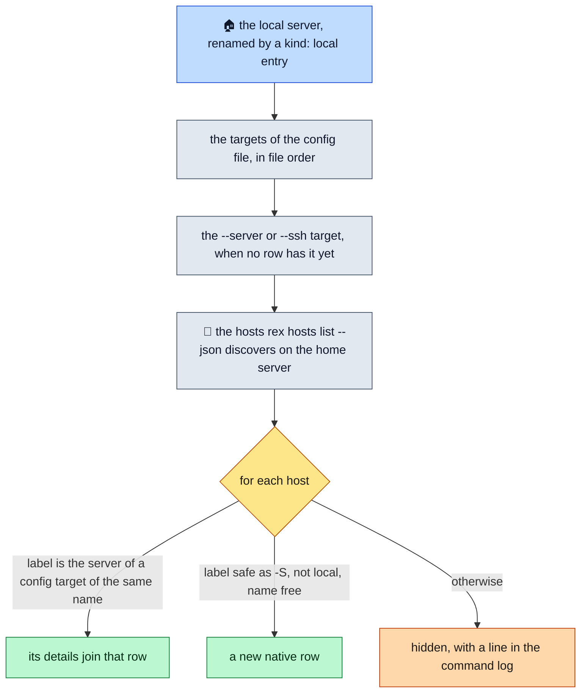

# Targets

> **A target is a Rex server lazyrex can show: the local one, a native host reached through `rex -S SERVER`, or Rex on another machine reached through `ssh`.** One target is active at a time; every panel, the event stream and every command use it.

## Three kinds

| Kind | Reached through | Comes from |
|---|---|---|
| `local` | `rex ARGS`, the local server | built in; one `kind: local` config entry may rename it |
| `native` | `rex -S SERVER ARGS`, where SERVER is a `rex hosts` label, a `host:port` or an `http(s)` URL | a `kind: native` config entry, `--server`, or `rex hosts list` |
| `ssh` | `ssh` to `ssh_host`, in forward or exec mode ([SSH targets](ssh.md)) | a `kind: ssh` config entry, or `--ssh` |

The Targets panel shows the kind as the transport column: `local`, `native` or `ssh`.

## How the list is built

The Targets panel lists, in order: the local server (renamed by a `kind: local` config entry), the `targets` of the config file, the `--server` target when it names none of them or the `--ssh` target when none has its `ssh_host`, then the hosts `rex hosts list --json` discovers on the home (local) server. A discovered host whose label is the server of a config target of the same name adds its details to that row. A host named `local`, one whose name is taken, and one whose label is unsafe as `-S` (empty, a leading `-`, outer whitespace, control characters, over 255 bytes) are hidden, with a line in the command log.

Target names are unique, ignoring case, at most 64 characters, and `local` is reserved for the built-in local target.

## The active target

- `enter` (or `space`) on another row activates it: the previous target's calls and stream are cancelled, its pending results dropped, and the panels re-read. `enter` on the active row re-reads it and the hosts.
- A command runs only on the target lazyrex observed when you started it: a key, a form or the palette started on one target never runs on another ([Safety](safety.md)).
- An SSH target in forward mode starts its tunnel once it is active and its remote endpoint is read; activating another target, or quitting, kills the tunnel and removes its socket.

## Checking targets

- `c` on the active row re-reads its `whoami` and `server status`. On an inactive row it reads them into that row only, without activating it. On an SSH row it also clears the probes and runs them again ([SSH targets](ssh.md)).
- An inactive row shows its last check, `checking…` while one runs, or else the result of `rex hosts check` for a native host. Its Status tab shows what that check read, never anything read on selection.
- Statuses and what to do about them: [Troubleshooting](troubleshooting.md).

## Discovered hosts

- `rex hosts list` and `rex version` always go to the home server. Hosts are re-read at start, on `R`, on `enter` on the active row and after a `hosts_changed` event, never on the poll timer.
- `rex hosts check --json` runs once after the first list with hosts, and for one host on `c` on its active row; rows show `reachable`, `unreachable`, `down`, or the status Rex gave. The Status tab counts check entries skipped (no label), unrecognized and matching no row.
- When the home server is stopped, the panel says **home server stopped** and hides the discovered hosts, except the active one; they come back when it runs again. A failed list keeps the last good one (**hosts: error**). When Rex reports the home server away, the Status tab says the hosts are as last reached.
- lazyrex never changes `rex hosts`: adding, editing and removing hosts is denied by the safety policy.

## Choosing the first target

`--server TARGET` (or `-S TARGET`) picks, ignoring case:

1. empty or `local`: the local target, even when the config renames it;
2. the name of a config target: that target;
3. anything else: a new ad-hoc native target named TARGET, reached through `rex -S TARGET`, if TARGET is safe as `-S`.

`--ssh HOST` picks the first config SSH target whose `ssh_host` is exactly HOST, else adds an ad-hoc SSH target named HOST in forward mode. It is refused when HOST is unsafe as an ssh destination, when another target already has that name, or when HOST is `local`. `--ssh` and `--server` are exclusive. Every refusal exits with status 2.

## Adding, editing, removing

These keys edit the `targets` list of the config file ([Configuration](configuration.md)):

- `a` adds a native or SSH target. Its menu offers a native target (`rex -S SERVER…`), each `Host` of `~/.ssh/config` no SSH target uses yet, in file order, and another SSH destination. On a discovered or `--server` row it adds that native target, prefilled; on an `--ssh` row it adds that SSH target. An SSH target asks for a destination, a name (by default the destination after its `@`) and a mode.
- `e` changes the name and server of a native config target, or the name, destination and mode of an SSH one; its `rex_path` and comments are kept.
- `d` removes a config target, after confirmation.

The file keeps its comments and other keys, is replaced atomically, and is refused if it changed on disk since lazyrex loaded it. Discovered hosts, the local target, `--server` and `--ssh` rows, and the active target cannot be edited: lazyrex never changes `rex hosts` or `~/.ssh/config`, and runs no command to edit the config. One edit runs at a time.

`~/.ssh/config` is read once at start, for `a`: only literal `Host` names, without wildcards or negations; `Include` is not followed.

## Starting and stopping servers

- `s` starts a stopped server with `rex server start --json`, the only call without `--autostart=false`, after confirming that exact command. It is offered on the local target and on SSH targets (where it runs over ssh), never on a native target: a stopped server there cannot receive it.
- `S` stops the server, after confirmation.
- Both act on the active target only: on another row they ask you to activate it first.
