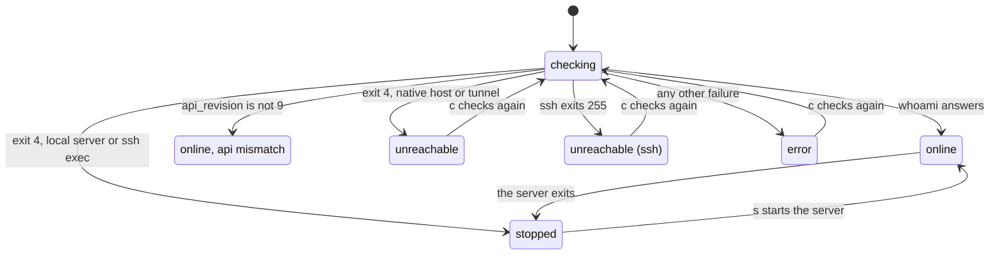

# Troubleshooting

> **What each target status, toast and exit code means, and what to do about it.** The Status tab of the Targets panel explains the active target's state, and the command log holds every command with its exit code and full stderr: look there first.

## Target states

| Status | Means | Do |
|---|---|---|
| `online` | `whoami` answered | nothing |
| `online, api mismatch` | the server's `api_revision`, or the local client's, is not 9. The Status tab says `WARNING: api mismatch, some calls may fail or show partial data.` | use a `rex` with API revision 9, or a lazyrex built for yours |
| `stopped` | the local server is not running: normal, it exits when its last session ends. On an SSH target, the remote server is not running | `s` starts it, after confirming the exact command |
| `unreachable` | a native host's server is down or unreachable from here; on an SSH target, ssh works but Rex does not answer through the tunnel | check that server; `s` is not offered on a native target; `c` checks again |
| `unreachable (ssh)` | ssh itself failed (exit 255: network, authentication or host key) | [SSH targets](ssh.md) |
| `error` | anything else; the Status tab shows the reason, such as `rex not found on remote-host (set rex_path)` or a missing runtime directory | read the reason, fix it, then `c` |
| `checking…`, `unknown` | a read is running, a tunnel is starting, or an inactive row was never checked | wait, or `c` on the row |

Leaving `online` drops the target's sessions and clients from the panels; they come back with it.

## Hosts and the event stream

- **home server stopped** (Targets subtitle): the local server is stopped, so the hosts `rex hosts list` discovers are hidden, except the active one. They come back when it runs again.
- **hosts: error**: the last `rex hosts list` failed; the last good list stays.
- **home away: hosts as last reached** (Status tab): Rex reports the home server away.
- `hosts: skipped ...` or `hosts: hid ...` in the command log: a discovered host had an unsafe label, the name `local`, or a name already taken ([Targets](targets.md)).
- **event stream down (polling)** (Status tab): `rex events --all --json` ended. lazyrex reconnects with backoff (1s up to 30s) and refreshes everything every `refresh.poll_interval` meanwhile.

## rex exit codes

| Exit | lazyrex reads it as | You see |
|---|---|---|
| 0 | success | the result |
| 2 | usage error | `invalid command (lazyrex bug or Rex version drift): COMMAND: LINE` |
| 3 | not found | `not found: LINE`, then the panels re-read |
| 4 | unreachable | `stopped` for the local server or over ssh exec, `unreachable` for a native host or a tunnel; a failed command toasts and checks the target |
| 130 | interrupted | nothing, as when lazyrex cancels a call because another target was activated or it quits |
| 255 | ssh failed, on an SSH route; else a failure | `unreachable (ssh)`, and a toast with ssh's first stderr line |
| anything else | failure | `error: LINE`, the first line of stderr |
| none | the call timed out | `error: timed out after 10s` (the `rex.timeout`) |
| none | `rex` could not start | `error:` and the reason, such as `rex` missing from `PATH` |

## lazyrex's own exit status

| Exit | When |
|---|---|
| 0 | you quit, or `--help` or `--version` |
| 1 | the terminal UI failed |
| 2 | a bad flag or an extra argument, `--ssh` with `--server`, a bad config, a bad key override, or a `--server` or `--ssh` value lazyrex refuses; it says why on stderr |

## Messages

| Message | Means |
|---|---|
| `refused: REASON` | the safety policy or a check refused the command; nothing ran ([Safety](safety.md)) |
| `the target changed; action cancelled`, `the target changed since the action started` | you activated another target, or the server restarted or went offline, while the action waited |
| `the route to remote-host changed since this command was prepared; run it again` | an SSH tunnel or mode changed during a confirmation |
| `activate NAME first (enter)` | `s` and `S` act on the active target only |
| `server start is not offered on a native (-S) target` | a stopped server there cannot receive it |
| `config not changed: the config file changed on disk since lazyrex loaded it` | restart lazyrex to load the file, then edit again |
| `the config file was replaced but may not be on disk yet` | the edit applied, but its directory could not be synced |
| `capture: --format=vt unsupported, using --format=text from now on` | this `rex` rejects `--format=vt`; captures lose their colors |
| `full-screen program: no scrollback, this is the current screen` | the block is on the alternate screen |
| `warning: REX_BLOCK "..." is not a full block ID; ignored` | lazyrex cannot protect its own block: `$REX_BLOCK` is not `block:...` |
| `warning: safety.allow_actions: "..." can never be allowed; ignored` | the allow-list names a host, pairing, listener or Tailscale operation |
| `events: skipped a malformed line: ...` | one event line was not JSON; the stream goes on |
| `no Rex app is connected` | `o` needs a connected Rex app |
| `unknown schema; use the palette: api call -s SESSION session.resize_pane {...}` | Rex describes no arguments for resize: type them in the palette |
